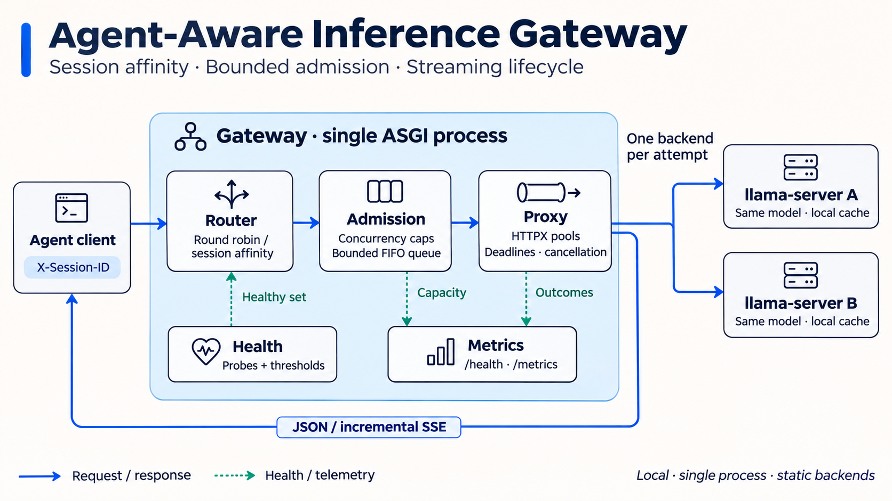

# Agent-Aware Inference Gateway

面向本地 `llama.cpp` 的 Python asyncio 推理网关，提供会话亲和路由、有界准入和 SSE 转发。项目重点是请求从排队到结束的资源管理，以及超时、断连和后端故障下的行为验证。

## 解决什么问题

Agent 的多轮请求往往重复携带相同上下文。轮询把同一会话分散到不同推理进程，会减少已有前缀缓存的复用机会；会话亲和则可能把负载集中到某个后端。网关用 `X-Session-ID` 保持会话归属，通过全局和后端并发限制、有界等待队列控制拥塞，并分别记录排队、执行和流式结束原因。

实现参考 [vLLM Router 的 routing design](https://github.com/vllm-project/production-stack/tree/main/src/vllm_router)。Session affinity、rendezvous hashing 和健康过滤都是已有方法，项目贡献是针对本地推理场景的工程实现与故障验证，不包含新路由算法。`Agent-Aware` 在这里指显式会话标识；网关不解析 Agent 工作流或工具调用。

## 架构



展示图对应的结构保留在可编辑的 [Mermaid 文件](docs/assets/architecture.mmd)和 [SVG 图](docs/assets/architecture.svg)中。[架构说明](docs/architecture.md)列出模块职责、重试边界和资源所有权。

- **路由**：`round_robin` 与 `session_affinity`；后者对 `X-Session-ID` 做 SHA-256 rendezvous hashing，缺少会话标识时使用轮询。
- **准入**：先选后端，再申请容量；全局和后端并发上限、有界队列、后端内 FIFO。
- **生命周期**：固定的请求期限和执行期限；仅连接建立前的失败可以重试，SSE 开始后不切换后端。
- **转发与观测**：原生 `/completion`、OpenAI 兼容 `/v1/chat/completions`；JSON 和 SSE；`/health` 与 Prometheus `/metrics`。

默认只监听 `127.0.0.1`，采用单进程和静态后端。完整边界见[限制](docs/limitations.md)。

## 安装与最简演示

需要 Python ≥3.11、[uv](https://docs.astral.sh/uv/)，以及已有的 `llama-server` 和 GGUF 模型。构建、下载与校验步骤见[运行手册](docs/runbook.md)。无需付费 API；模型和推理引擎不随仓库分发。

从仓库根目录运行：

```bash
uv sync --locked
export LLAMA_SERVER="/path/to/llama.cpp/build/bin/llama-server"
export GATEWAY_MODEL="/path/to/qwen2.5-0.5b-instruct-q4_0.gguf"

uv run --locked python -m bench.demo --outdir bench/results/demo
```

演示启动两个 CPU 后端和网关，连续发送同一会话请求，打印后端与 `cache_n`，然后停止演示自身启动的首选后端，等待健康摘除后验证请求迁移。输出包括 `summary.json`、运行配置和日志；结束时清理自身子进程。默认占用 `18080`、`18090`、`18091`，已有服务占用时退出。可用 `--gateway-port`、`--port-a`、`--port-b` 改端口。

演示展示机制和单次结果；缓存命中与故障迁移的观察不能代替完整性能矩阵。

## 手动运行

```bash
cp config.example.toml config.toml
export LLAMA_ARG_DEVICE=none
export LLAMA_ARG_N_GPU_LAYERS=0
./scripts/start_backends.sh
uv run --locked python -m gateway --config config.toml
```

在另一个终端请求网关：

```bash
curl --fail-with-body -N http://127.0.0.1:18080/completion \
  -H 'Content-Type: application/json' \
  -H 'X-Session-ID: demo-session' \
  -d '{"prompt":"Say hello in one sentence.","n_predict":8,"stream":true,"cache_prompt":true}'

curl --fail-with-body http://127.0.0.1:18080/health
curl --fail-with-body http://127.0.0.1:18080/metrics
```

响应头 `X-Gateway-Backend` 标识实际后端，`X-Gateway-Queue-Ms` 表示排队时间。原生 llama.cpp SSE 的正常结束标志是完整事件中的 `stop: true`。HTTP 200 或连接关闭都不足以证明生成完成。

使用 Ctrl-C 停止网关，再执行 `./scripts/stop_backends.sh`。详细请求示例、真实 E2E 和故障演练见[运行手册](docs/runbook.md)。

## 测试与证据

```bash
uv run --locked pytest -q tests bench/tests -m 'not real_backend'

# 需要上面的 LLAMA_SERVER、GATEWAY_MODEL；独立启动两个测试后端
GATEWAY_REAL_BACKENDS=1 \
LLAMA_ARG_DEVICE=none LLAMA_ARG_N_GPU_LAYERS=0 \
uv run --locked pytest -q -m real_backend
```

单元测试覆盖路由、配置、准入状态机与 SSE 分帧。HTTP 集成测试启动真实 Uvicorn 和可控假后端，检查增量转发、容量回收和故障交错；真实后端测试用于确认 llama.cpp 协议兼容及会话缓存复用。修复后的本次执行记录集中在[发布验证记录](docs/release-verification.md)，不引用仓库外研究材料作为公开验收证据。

测试通过只覆盖相应用例。网关任务结束、上游连接关闭和推理引擎内部停止计算是不同层次；当前证据不证明所有内部 KV 或 slot 操作均已取消。

## Benchmark 口径

```bash
uv run --locked python -m bench.run_bench --repeat 5 \
  --workloads sequential,shuffled,negative --strategies b0,b1 \
  --outdir bench/results/route
uv run --locked python -m bench.run_admission_bench --repeat 5 \
  --outdir bench/results/admission
uv run --locked python -m bench.run_reliability_bench --repeat 5 \
  --outdir bench/results/reliability
uv run --locked python -m bench.run_soak --outdir bench/results/soak
```

这些命令共享后端端口，应依次执行。B0 为轮询，B1 为会话亲和；比较固定模型、提示与请求顺序，每个策略和重复轮次重启后端及网关。原始记录与环境信息由脚本写入输出目录。

完整流式完成才计入成功。报告须同时给出 offered、completed、拒绝、超时和错误数量；完成请求的 p50/p95 不代表全部用户请求的延迟。历史结果尚未按修正后的 SSE 完成规则和固定 CPU 条件重跑，因此 README 不保留历史性能提升数字。详细实验条件和公式见[Benchmark 说明](docs/benchmarks.md)。

## 使用范围与限制

该项目适合作为受信任本机环境中的工程实验和学习展示。它没有鉴权、TLS 终止和多租户隔离，也没有请求体大小限制、完整熔断器或 Kubernetes 服务发现。会话亲和不等于负载均衡，也不感知前缀内容或 KV-cache 位置。单机 0.5B 模型结果不能外推至 GPU 生产服务。

部署边界、流式状态码和健康恢复行为见[限制](docs/limitations.md)；指标含义见[指标说明](docs/metrics.md)。[工程讲解提纲](docs/engineering-review.md)可用于准备代码演示。

## 许可证与发布

项目代码采用 [MIT License](LICENSE)。Python 依赖、llama.cpp 和模型各自保留其许可证；设计参考及依赖清单见[第三方说明](docs/third-party.md)。本地公开发布前检查见[发布清单](docs/release-checklist.md)。
