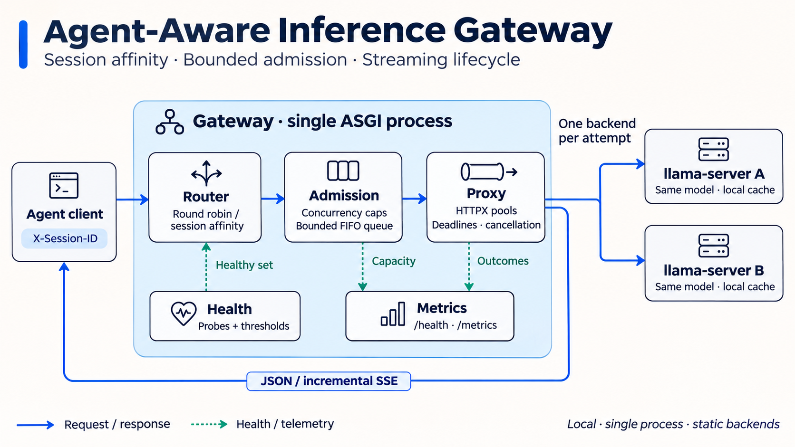

# 架构与请求生命周期

网关在一个 ASGI 进程和事件循环中运行，连接静态配置的本地推理后端。它转发请求，不保存 Agent 会话内容；`X-Session-ID` 仅用于选择后端。



展示图突出网关边界和数据流；[Mermaid 源文件](assets/architecture.mmd)及其 [SVG 图](assets/architecture.svg)保留可编辑结构。实线表示请求或响应数据路径，虚线表示健康状态和观测数据。图中两个后端运行相同模型；健康探测使用独立于推理的 HTTPX 客户端，展示图省略了这条独立探测连接。

## 模块职责

| 模块 | 职责 |
|---|---|
| `server.py` | HTTP 路由、应用 lifespan、admin 鉴权/审计、CLI、健康摘要 |
| `config.py` | TOML 读取与启动前校验 |
| `router.py` | 轮询、会话亲和、前缀亲和、KV-cache-aware、健康过滤和故障迁移决策 |
| `prefix.py` | prompt 提取、SHA-256 字符块/token trie、TTL/LRU、缓存命中证据 |
| `tokenizer.py` | 可选的 llama.cpp `/tokenize` 客户端与有界缓存 |
| `admission.py` | 容量、等待队列、准入票据、drain 与终态 |
| `backends.py` | 推理/探测 HTTP 客户端、健康探测与状态去抖 |
| `proxy.py` | 转发、请求体上限、期限、取消、重试与资源清理 |
| `middleware.py` | `X-Request-ID` 生成/透传与日志上下文 |
| `sse.py` | 增量事件解析，用于指标观察；转发保留原始字节 |
| `metrics.py` | Prometheus 指标注册与导出 |

## 从到达到结束

1. `/completion`、`/v1/chat/completions`、`/v1/completions` 或 `/v1/embeddings` 的已匹配路由决定上游端点。请求体按 `max_request_body_bytes` 流式读取；超限在准入前返回 413。`/v1/models` 是只读转发，不占用推理容量。
2. 若配置了 `prefix.tokenizer_url`，先调用 llama.cpp `/tokenize` 得到 token id；失败则回退到字符块。Router 在健康后端中选择目标。`session_affinity` 的首选后端由全部配置后端决定；首选不可用时，在健康子集中重新选择。`prefix_affinity` 匹配曾服务该前缀的后端；`kv_cache_aware` 另外优先有真实 `cache_n > 0` 证据的后端。没有可用前缀匹配时回退到会话/轮询。恢复后立即回到原首选。
3. Admission controller 申请全局和目标后端容量。容量不足时进入有界队列；队列已满返回 `429 queue_full`。等待队列按后端保持 FIFO，跨后端选择最早可执行的等待者。
4. 获得票据后，通过该后端的长连接池发送请求。JSON 完整读取后返回；SSE 按上游字节块逐步转发，指标解析与转发内容分开。
5. JSON 正文读完即释放后端票据，下游发送仍受固定期限约束；SSE 持有票据至流结束。失败路径回收票据并关闭未移交的上游响应。票据释放幂等，SSE 的响应级清理还覆盖迭代器未启动的退出路径。

容量计数更新在同一事件循环内同步完成，更新过程中不执行 I/O。该模型依赖单进程运行；多 worker 会分别维护容量和指标。

## 路由

会话亲和使用 rendezvous hashing：

```text
score = int.from_bytes(SHA256(backend_id + NUL + session_id)[:8], "big")
winner = argmax(score, backend_id)
```

SHA-256 使映射不受 Python 字符串哈希随机化影响；后端 ID 作为相同分数的稳定次序。缺少或为空的 `X-Session-ID` 使用轮询。路由先于准入，拒绝也会推进轮询计数；排队期间不主动迁移后端。

前缀策略会读取提示词以构建字符块或 token 前缀；它仍然不知道 KV block 位置。文本/ token 匹配和 `cache_n > 0` 证据分开记录，前者不冒充后者。设计参考 [vLLM Router](https://github.com/vllm-project/production-stack/tree/main/src/vllm_router)，实现范围与来源见[第三方说明](third-party.md)。

## 期限与重试

请求期限以到达时间为起点，执行期限以首次准入时间为起点，均采用 monotonic clock：

```text
request_deadline = arrival + request_timeout_ms
execution_deadline = min(request_deadline, first_admission + execution_timeout_ms)
```

两者不因重试或后端切换重置。正常 JSON 与 SSE 下游发送也受剩余期限约束；若响应开始前预算已耗尽，真实 504 的错误发送最多使用 50 ms 宽限。首次排队受队列超时和请求剩余时间约束；重试排队还受已开始的执行期限约束。响应头发出前的期限耗尽可返回 504；头部已发出后只能终止传输，不能修改已发送状态码。

只有 `ConnectError` 或 `ConnectTimeout` 可以在剩余预算和重试次数内改用另一个健康后端。读取超时、协议错误、上游 5xx 和响应头后的失败不自动重试，因为请求可能已经执行。重试前释放旧后端票据，再申请新票据，不同时占用两个后端名额。

[限制](limitations.md)定义期限与下游发送的实际覆盖范围；[发布验证记录](release-verification.md)记录对应回归检查结果。

## 健康状态

启动探测按一次结果确定初始健康状态。运行时连续 `failure_threshold` 次失败摘除，连续 `success_threshold` 次成功恢复；网络错误也会计入失败。单次业务 5xx 不改变健康状态。

没有健康后端时返回 `503 no_healthy_backend`。恢复采用立即 failback，可能再次损失缓存并集中负载。健康状态也会从成功的业务响应得到恢复信号，但已健康的后端不会因单次业务成功重置探测失败计数。loopback admin 端点可立即触发探测。健康探测使用独立 HTTPX 客户端和 `health.timeout_s` 总超时，推理连接池饱和不会直接耗尽探测连接。

运行时可通过 `/admin/backends` 增加/删除后端；删除要求该后端没有 active/queued 请求，且不能删除最后一个后端。`/drain` 先停止新路由、等待存量完成后删除；超时保持 draining，`/undrain` 可恢复。router、准入和前缀 trie 都增量更新，保留其余后端的学习状态。drain 和进程关闭都受 `drain_timeout_s` / `shutdown_timeout_s` 约束。`/admin/cache` 只转发 `/slots` 的缓存 token 计数供观察，不作为路由依据。

## 请求关联

中间件接受形状合法的 `X-Request-ID`，否则生成 32 位十六进制 ID；该 ID 写入响应头、日志上下文和上游请求。`traceparent`/`tracestate` 按普通请求头透传，因此外部 tracing 系统可以把网关 hop 串起来。网关本身不依赖 OpenTelemetry SDK，也不导出 span。

## SSE 与资源边界

HTTP chunk 不等于 SSE event。网关按原始 chunk 顺序转发，解析器另外处理跨块分帧。原生 llama.cpp 以完整 `stop: true` 事件表示生成完成；OpenAI 兼容流通常使用 `[DONE]`。网关不补写完成事件。

客户端断开或期限耗尽时，应关闭网关持有的上游响应并释放票据。连接关闭不证明推理引擎内部立即停止计算，真实后端的 `requests_processing` 只能提供外部可观察的补充信息。

## 修改与渲染图示

修改 `assets/architecture.mmd` 后，用 Mermaid CLI 生成 SVG：

```bash
mmdc -i docs/assets/architecture.mmd -o docs/assets/architecture.svg -b white
```

`architecture-overview.png` 是 README 使用的展示图，不能通过上述命令重新生成。架构变更时，同时更新 Mermaid 结构图和展示图，并核对文字、箭头及缩放后的可读性。Mermaid CLI 只用于文档生成，不是网关运行依赖。
