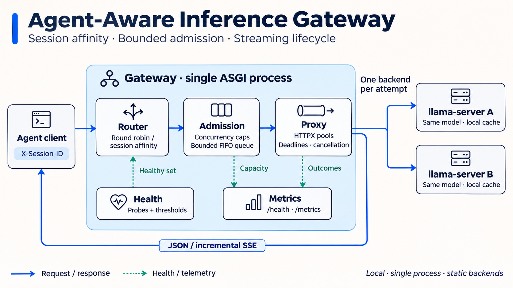

# 架构与请求生命周期

网关在一个 ASGI 进程和事件循环中运行，连接静态配置的本地推理后端。它转发请求，不保存 Agent 会话内容；`X-Session-ID` 仅用于选择后端。



展示图突出网关边界和数据流；[Mermaid 源文件](assets/architecture.mmd)及其 [SVG 图](assets/architecture.svg)保留可编辑结构。实线表示请求或响应数据路径，虚线表示健康状态和观测数据。图中两个后端运行相同模型，健康探测与推理共用各后端的 HTTPX 客户端。展示图的返回箭头指向同一客户端；健康探测到后端的 HTTP 交互从图中省略。

## 模块职责

| 模块 | 职责 |
|---|---|
| `server.py` | 四个 HTTP 路由、应用 lifespan、CLI、健康摘要 |
| `config.py` | TOML 读取与启动前校验 |
| `router.py` | 轮询、会话亲和、健康过滤和故障迁移决策 |
| `admission.py` | 容量、等待队列、准入票据及终态 |
| `backends.py` | HTTP 客户端连接池、健康探测与状态去抖 |
| `proxy.py` | 转发、期限、取消、重试与资源清理 |
| `sse.py` | 增量事件解析，用于指标观察；转发保留原始字节 |
| `metrics.py` | Prometheus 指标注册与导出 |

## 从到达到结束

1. `/completion` 或 `/v1/chat/completions` 的已匹配路由决定上游端点。读取请求体，提取会话标识；请求体完整读入内存后再转发。
2. Router 在健康后端中选择目标。`session_affinity` 的首选后端由全部配置后端决定；首选不可用时，在健康子集中重新选择。恢复后立即回到原首选。
3. Admission controller 申请全局和目标后端容量。容量不足时进入有界队列；队列已满返回 `429 queue_full`。等待队列按后端保持 FIFO，跨后端选择最早可执行的等待者。
4. 获得票据后，通过该后端的长连接池发送请求。JSON 完整读取后返回；SSE 按上游字节块逐步转发，指标解析与转发内容分开。
5. JSON 正文读完即释放后端票据，下游发送仍受固定期限约束；SSE 持有票据至流结束。失败路径回收票据并关闭未移交的上游响应。票据释放幂等，SSE 的响应级清理还覆盖迭代器未启动的退出路径。

容量计数更新在同一事件循环内同步完成，更新过程中不执行 I/O。该模型依赖单进程运行；多 worker 会分别维护容量和指标。

## 路由

会话亲和使用 rendezvous hashing：

```text
score = int.from_bytes(SHA256(backend_id + NUL + session_id)[:8], "big")
winner = argmax(score, backend_id)
```

SHA-256 使映射不受 Python 字符串哈希随机化影响；后端 ID 作为相同分数的稳定次序。缺少或为空的 `X-Session-ID` 使用轮询。路由先于准入，拒绝也会推进轮询计数；排队期间不主动迁移后端。

会话标识不代表前缀内容或 KV-cache 位置，路由不会读取提示词来匹配前缀。设计参考 [vLLM Router](https://github.com/vllm-project/production-stack/tree/main/src/vllm_router)，实现范围与来源见[第三方说明](third-party.md)。

## 期限与重试

请求期限以到达时间为起点，执行期限以首次准入时间为起点，均采用 monotonic clock：

```text
request_deadline = arrival + request_timeout_ms
execution_deadline = min(request_deadline, first_admission + execution_timeout_ms)
```

两者不因重试或后端切换重置。正常 JSON 与 SSE 下游发送也受剩余期限约束；若响应开始前预算已耗尽，真实 504 的错误发送最多使用 50 ms 宽限。首次排队受队列超时和请求剩余时间约束；重试排队还受已开始的执行期限约束。响应头发出前的期限耗尽可返回 504；头部已发出后只能终止传输，不能修改已发送状态码。

只有 `ConnectError` 或 `ConnectTimeout` 可以在剩余预算和重试次数内改用另一个健康后端。读取超时、协议错误、上游 5xx 和响应头后的失败不自动重试，因为请求可能已经执行。重试前释放旧后端票据，再申请新票据，不同时占用两个后端名额。

[限制](limitations.md)定义期限与下游发送的实际覆盖范围；[发布验证记录](release-verification.md)记录对应回归检查结果。

## 健康状态

启动探测按一次结果确定初始健康状态。运行时连续 `failure_threshold` 次失败摘除，连续 `success_threshold` 次成功恢复；网络错误也会计入失败。单次业务 5xx 不改变健康状态。

没有健康后端时返回 `503 no_healthy_backend`。Session affinity 的恢复采用立即 failback，可能再次损失缓存并集中负载。健康探测使用同一个 HTTPX 池，连接池拥塞会影响探测时效。

## SSE 与资源边界

HTTP chunk 不等于 SSE event。网关按原始 chunk 顺序转发，解析器另外处理跨块分帧。原生 llama.cpp 以完整 `stop: true` 事件表示生成完成；OpenAI 兼容流通常使用 `[DONE]`。网关不补写完成事件。

客户端断开或期限耗尽时，应关闭网关持有的上游响应并释放票据。连接关闭不证明推理引擎内部立即停止计算，真实后端的 `requests_processing` 只能提供外部可观察的补充信息。

## 修改与渲染图示

修改 `assets/architecture.mmd` 后，用 Mermaid CLI 生成 SVG：

```bash
mmdc -i docs/assets/architecture.mmd -o docs/assets/architecture.svg -b white
```

`architecture-overview.png` 是 README 使用的展示图，不能通过上述命令重新生成。架构变更时，同时更新 Mermaid 结构图和展示图，并核对文字、箭头及缩放后的可读性。Mermaid CLI 只用于文档生成，不是网关运行依赖。
